English | [繁體中文](README_zh.md)

  
  <h1>Max97k</h1>
  
<strong>Embedded Systems, Edge AI & Systems Software Engineer</strong>

  
<em>Firmware Architecture • Silicon Enablement • Offline AI Runtimes • Android Systems</em>

  

    
    
    
  

---

## Table of Contents

- [About Me](#about-me)
- [Technical Domain Architecture](#technical-domain-architecture)
- [Skills & Technology Stack](#skills--technology-stack)
- [Featured Open-Source Projects](#featured-open-source-projects)
- [Engineering Philosophy](#engineering-philosophy)
- [GitHub Analytics](#github-analytics)
- [License & Disclaimers](#license--disclaimers)

---

## About Me

I specialize in **embedded systems architecture**, **silicon enablement**, and **edge intelligence**. My technical journey spans digital logic design, high-reliability automotive and IoT microcontroller firmware (C/C++), modern Android systems (Kotlin / Jetpack Compose), and production-grade on-device AI integration (quantized LLMs, Ollama, ONNX).

- 🎯 **Primary Focus**: Low-latency edge inference, bare-metal and RTOS firmware, privacy-first desktop utilities, and developer tooling.
- 💡 **Engineering Approach**: Building high-efficiency, offline-capable systems with zero compromise on end-user privacy.

---

## Technical Domain Architecture

```mermaid
flowchart LR
    subgraph Silicon["Hardware & Silicon Level"]
        MCU[Automotive & IoT MCUs\nARM Cortex-M / Cortex-A]
        HDL[Digital Design & FPGA\nVerilog / SystemVerilog]
    end

    subgraph Firmware["Low-Level & Firmware Systems"]
        RTOS[FreeRTOS / Bare-Metal\nC & C++ Architecture]
        DEBUG[Probes & Debuggers\nOpenSDA / GDB / JTAG]
    end

    subgraph EdgeAI["Edge Intelligence & Desktop"]
        LOCAL_AI[Offline LLM Runtimes\nLocal Quantized Models / Ollama]
        CV[Computer Vision & OCR\nRapidOCR / ONNX Runtime]
    end

    subgraph Apps["Applications & Cloud Systems"]
        ANDROID[Modern Mobile\nKotlin / Jetpack Compose]
        SERVERLESS[Serverless Automation\nCloud Functions / WireGuard]
        DEVTOOLS[Developer Tools\nReact / D3.js / Node.js]
    end

    Silicon --> Firmware
    Firmware --> EdgeAI
    EdgeAI --> Apps
```

---

## Skills & Technology Stack

| Domain | Technologies & Frameworks |
|---|---|
| **Embedded & Silicon** | C, C++, ARM Cortex-M/A/R, FreeRTOS, AUTOSAR concepts, UART, SPI, I2C, CAN, Verilog HDL |
| **Edge AI & Machine Learning** | Python, Ollama, Quantized LLMs, ONNX Runtime, RapidOCR, Transformers, GGUF runtimes |
| **Mobile & Android** | Kotlin, Jetpack Compose, Coroutines, Flow, Architecture Components (MVVM/MVI), Room DB |
| **Cloud & DevOps** | Serverless Cloud Functions, Docker, WireGuard, GitHub Actions CI/CD |
| **Frontend & Visualization** | React 18, Vite, D3.js, Tailwind CSS, WebSockets, Node.js |

---

## Featured Open-Source Projects

### 🚗 Embedded & Automotive Systems

- **[s32k144w-rtd-rainbow-led](https://github.com/Max97k/s32k144w-rtd-rainbow-led)**  
  *Automotive RTD Hardware FTM PWM & 10 kHz PDM Rainbow LED Engine.*  
  Engineered for the NXP S32K144W (Cortex-M4F) using official Real Time Drivers (RTD 3.0.0). Features 1.0 MHz Sigma-Delta PDM, 32-bit Galois LFSR spread-spectrum EMI modulation (CISPR 25 Class 5), and closed-loop virtual RC thermal droop compensation.

- **[s32k1-coremark-port](https://github.com/Max97k/s32k1-coremark-port)**  
  *Hardware-Validated EEMBC CoreMark 1.0 Port for NXP S32K144W.*  
  Zero-overhead cycle timing utilizing ARM Cortex-M4 DWT hardware counters (`DWT->CYCCNT`), automated UART reporting, and full environment BOM specification.

- **[imx91-rgb-controller](https://github.com/Max97k/imx91-rgb-controller)**  
  *Matter / Thread RGB LED Controller on NXP i.MX 91 (Cortex-A55).*  
  High-speed WS2812/WS2814 LED timing via Linux SPI DMA serialization, 74AHCT125 level-shifting, and real-time Matter cluster synchronization.

### 🤖 Edge AI & Desktop Utilities

- **[TOST](https://github.com/Max97k/TOST)**  
  *Offline Screen Translator for Windows & Linux powered by Gemma & Ollama.*  
  Air-gapped desktop OCR screen translator. Captures display regions, extracts text via ONNX RapidOCR, and produces idiomatic translations using local quantized models with zero external cloud dependencies.

- **[see-agy](https://github.com/Max97k/see-agy)**  
  *Real-time 2D Treemap Visualizer Dashboard for Autonomous AI Agent Sessions.*  
  Live-streams file mutations, reads, and agent states with an interactive D3.js Treemap and GPU-accelerated canvas alpha decay rendering.

### 📱 High-Performance Android & Mobile Applications

- **[GPSPY](https://github.com/Max97k/GPSPY)**  
  *Offline-First 3D GPS Trajectory Tracker & Daily Pattern Analyzer.*  
  Built with Kotlin and Jetpack Compose. Features background elevation tracking, multi-satellite GNSS monitoring, 5-minute debounced routine state machines, and local GPX export.

- **[money2](https://github.com/Max97k/money2)**  
  *Privacy-First Investment Portfolio Manager for Android.*  
  Local-first portfolio tracker built with Jetpack Compose, Clean Architecture, and Hardware-Backed Keystore encryption.

- **[PDDF](https://github.com/Max97k/PDDF)**  
  *Batch PDF Decryptor for Android.*  
  100% offline, privacy-first Android utility built with Kotlin and Jetpack Compose, featuring hardware `FLAG_SECURE` window protection.

- **[WatchMyMoney](https://github.com/Max97k/WatchMyMoney)**  
  *Real-Time 60fps Wear OS Income Complication & Tracker.*  
  Dual-component Wear OS application featuring high-efficiency passive complications and a 60Hz real-time earnings visualizer.

---

## Engineering Philosophy

1. **Privacy by Default**: User data belongs on user hardware. When on-device inference or offline storage is viable, prioritize it over cloud dependency.
2. **Minimalism & Efficiency**: Optimize low-level resource utilization, avoiding speculative abstractions and excessive dependencies.
3. **Silicon-to-UI Coherence**: True systems engineering requires understanding the layers beneath—from CPU pipelines, registers, and memory buses up to user interfaces.

---

## GitHub Analytics

  
  

---

## License & Disclaimers

- Distributed under the [MIT License](LICENSE).
- All referenced trademarks, logos, and company names are the property of their respective owners.
