English | [繁體中文](README_zh.md)

  
  <h1>Max Kuo (郭曜銘)</h1>
  
<strong>Field Application Engineer (FAE) at NXP Semiconductors</strong>

  
<em>Embedded Systems Architecture • Edge AI Acceleration • Cloud & Desktop Automation • Android Systems</em>

  

    
    
    
    
    
  

---

## Table of Contents

- [About Me](#about-me)
- [Technical Domain Architecture](#technical-domain-architecture)
- [Skills & Technology Stack](#skills--technology-stack)
- [Featured Open-Source Projects](#featured-open-source-projects)
- [Engineering Philosophy](#engineering-philosophy)
- [GitHub Analytics](#github-analytics)
- [Connect & Collaborate](#connect--collaborate)
- [Trademarks & Attributions](#trademarks--attributions)

---

## About Me

I specialize in **technical enablement**, **embedded solution architecture**, and **edge intelligence**, bridging the gap between cutting-edge silicon R&D and tier-one client deployment. My technical journey spans digital hardware design (Verilog / FPGA), high-reliability embedded firmware (C/C++), enterprise-grade Android engineering (Kotlin / Jetpack Compose), and production-grade Edge AI integration (quantized LLMs, Ollama, ONNX).

- 🏢 **Current Role**: Field Application Engineer (FAE) at **NXP Semiconductors**, driving customer enablement for automotive and industrial microcontrollers and processors (S32 family, i.MX series).
- 🎯 **Primary Focus**: Low-latency edge inference, silicon-level debugging, privacy-first desktop utilities, and serverless developer tooling.
- 💡 **Passion**: Building high-efficiency, offline-capable systems with zero compromise on end-user privacy.

---

## Technical Domain Architecture

```mermaid
flowchart LR
    subgraph Silicon["Hardware & Silicon Level"]
        MCU[Automotive & IoT MCUs\nS32K / i.MX / ARM Cortex]
        HDL[Digital Design & FPGA\nVerilog / SystemVerilog]
    end

    subgraph Firmware["Low-Level & Firmware Systems"]
        RTOS[FreeRTOS / Bare-Metal\nC & C++ Architecture]
        DEBUG[Probes & Debuggers\nLauterbach / S32DS / GDB]
    end

    subgraph EdgeAI["Edge Intelligence & Desktop"]
        LOCAL_AI[Offline LLM Runtimes\nGoogle Gemma / Ollama / GGUF]
        CV[Computer Vision & OCR\nRapidOCR / ONNX Runtime]
    end

    subgraph Apps["Applications & Cloud Systems"]
        ANDROID[Modern Mobile\nKotlin / Jetpack Compose]
        SERVERLESS[Cloud & Micro-Utilities\nGCP Functions / WireGuard]
        DEVTOOLS[Agentic Developer Tools\nReact / D3.js / Node.js]
    end

    Silicon --> Firmware
    Firmware --> EdgeAI
    EdgeAI --> Apps
```

---

## Skills & Technology Stack

| Domain | Technologies & Frameworks |
|---|---|
| **Embedded & Silicon** | C, C++, ARM Cortex-M/A/R, NXP S32DS, i.MX, FreeRTOS, AUTOSAR basics, UART, SPI, I2C, CAN, Verilog HDL |
| **Edge AI & Machine Learning** | Python, Ollama, Google Gemma, PyTorch, ONNX Runtime, RapidOCR, HuggingFace Transformers, Quantization (GGUF, AWQ) |
| **Mobile & Android** | Kotlin, Jetpack Compose, Coroutines, Flow, Architecture Components (MVVM/MVI), Room DB, Biometrics API |
| **Cloud & DevOps** | Google Cloud Platform (Cloud Functions 2nd Gen, Secret Manager, Compute Engine), Docker, WireGuard, CI/CD Actions |
| **Frontend & Visualization** | React 18, Vite, D3.js, Tailwind CSS, Socket.io, Node.js, WebSockets |

---

## Featured Open-Source Projects

### 🤖 Edge AI & Desktop Utilities

- **[TOST (Translategemma)](https://github.com/Max97k/TOST)**  
  *Offline Screen Translator for Windows & Linux powered by Google Gemma & Ollama.*  
  Air-gapped, zero-latency desktop OCR screen translator. Captures display selections via Tkinter overlay, extracts text with RapidOCR (ONNX), and produces idiomatic Traditional Chinese translations using local quantized Gemma models without sending bytes to the cloud.

- **[see-agy](https://github.com/Max97k/see-agy)**  
  *Real-time 2D Treemap Visualizer Dashboard for Google Antigravity (AGY) Agent Sessions.*  
  A non-invasive observability tool live-streaming file mutations, read events, and agent states with an interactive D3.js Treemap and a 1.5-second GPU-accelerated canvas alpha decay engine.

### 🛡️ Cloud, Privacy & Network Automation

- **[GCP-Telegram-VPN-Bot](https://github.com/Max97k/GCP-Telegram-VPN-Bot)**  
  *Serverless Disposable WireGuard/OpenVPN Bot on Google Cloud Platform.*  
  Deploys ephemeral, high-speed WireGuard VPN servers on GCP Compute Engine Spot instances on demand via Telegram commands (`/new`, `/del`), dropping idle costs to $0. Automatically provisions swap, keys, and returns in-chat connection QR codes.

- **[cloudflare-gateway-pihole-scripts](https://github.com/kuoyaoming/cloudflare-gateway-pihole-scripts)**  
  *Automated Cloudflare Gateway Pi-hole Alternative.*  
  Automates the synchronisation of community blocklists and threat intelligence to Cloudflare Zero Trust Gateway, providing zero-maintenance DNS-level malware and ad-blocking without dedicated hardware.

### 📱 High-Performance Android Applications

- **[GPSPY](https://github.com/kuoyaoming/GPSPY)**  
  *Professional 3D Offline GPS Track Recorder & Visualizer.*  
  Built with Kotlin and Jetpack Compose. Offers offline elevation tracking, track analysis, automated Google Play CI/CD pipelines, and privacy-preserving local GPX storage.

- **[Wealth-Manager](https://github.com/kuoyaoming/Wealth-Manager)**  
  *Biometrically Secured Personal Wealth & Asset Tracker.*  
  Clean Android personal finance tracker featuring hardware-backed BiometricPrompt authentication, encrypted local storage, and currency conversion telemetry.

---

## Engineering Philosophy

1. **Privacy by Default**: User data belongs on user hardware. When local inference or offline storage is viable, choose it over cloud lock-in.
2. **Cost-to-Zero Architecture**: Ephemeral infrastructure should exist only when in active use. Serverless scaling to zero prevents cloud bill shock.
3. **Rigorous Silicon-to-UI Empathy**: High-level developer experience requires understanding the silicon layers beneath—from CPU pipelines and cache lines up to React render trees.

---

## GitHub Analytics

  
  

---

## Connect & Collaborate

- 💼 **LinkedIn**: [linkedin.com/in/maxnxp](https://www.linkedin.com/in/maxnxp/)
- 🐙 **GitHub (Primary)**: [@kuoyaoming](https://github.com/kuoyaoming)
- 🐙 **GitHub (Workspace / Projects)**: [@Max97k](https://github.com/Max97k)
- 🤝 **Collaboration**: Welcoming discussions on automotive embedded AI, edge LLM optimization, and autonomous developer tooling.

---

## Trademarks & Attributions

- **NXP®** and the NXP logo are trademarks of NXP B.V.
- **Google®**, **Gemma™**, **Android™**, and **Google Cloud Platform®** are trademarks or registered trademarks of Google LLC.
- **Telegram®** is a registered trademark of Telegram FZ-LLC.
- **WireGuard®** is a registered trademark of Jason A. Donenfeld.
- All other trademarks and logos are the property of their respective owners.
