[English](README.md) | 繁體中文

  
  <h1>Max97k</h1>
  
<strong>嵌入式系統、邊緣 AI 與系統軟體工程師</strong>

  
<em>韌體架構 • 晶片落地賦能 • 離線 AI 推論 • Android 系統研發</em>

  

    
    
    
  

---

## 目錄

- [個人簡介](#個人簡介)
- [專業技術領域架構圖](#專業技術領域架構圖)
- [核心專業技能與技術矩陣](#核心專業技能與技術矩陣)
- [精選開源代表專案](#精選開源代表專案)
- [工程哲學與理念](#工程哲學與理念)
- [GitHub 統計數據](#github-統計數據)
- [授權與免責宣告](#授權與免責宣告)

---

## 個人簡介

我專注於**嵌入式系統架構**、**晶片方案落地**以及**邊緣智慧 (Edge Intelligence)**。我的工程經驗涵蓋數位邏輯電路設計、高可靠性車用與物聯網微控制器韌體 (C/C++)、現代 Android 應用架構 (Kotlin / Jetpack Compose)，以及生產級端側 AI 部署 (量化大語言模型、Ollama、ONNX)。

- 🎯 **主要專注**: 低延遲邊緣推論、裸機與 RTOS 韌體、隱私優先桌面工具，以及開發者自動化工作流。
- 💡 **工程理念**: 打造高效率、可離線運行且絕不妥協使用者隱私的軟硬體整合系統。

---

## 專業技術領域架構圖

```mermaid
flowchart LR
    subgraph Silicon["硬體電路與晶片層"]
        MCU[車用與邊緣處理器\nARM Cortex-M / Cortex-A]
        HDL[數位邏輯設計 & FPGA\nVerilog / SystemVerilog]
    end

    subgraph Firmware["韌體與底層系統層"]
        RTOS[即時作業系統 FreeRTOS / Bare-Metal\nC & C++ 高可靠架構]
        DEBUG[硬體除錯器與驅動\nOpenSDA / GDB / JTAG]
    end

    subgraph EdgeAI["邊緣智慧與桌面端軟體"]
        LOCAL_AI[離線大語言模型推論核心\n本地量化模型 / Ollama]
        CV[電腦視覺與光學文字辨識\nRapidOCR / ONNX Runtime]
    end

    subgraph Apps["應用軟體與自動化系統"]
        ANDROID[現代行動應用\nKotlin / Jetpack Compose]
        SERVERLESS[無伺服器自動化\nCloud Functions / WireGuard]
        DEVTOOLS[開發者視覺化工具\nReact / D3.js / Node.js]
    end

    Silicon --> Firmware
    Firmware --> EdgeAI
    EdgeAI --> Apps
```

---

## 核心專業技能與技術矩陣

| 領域 | 核心技術與框架 |
|---|---|
| **嵌入式與晶片韌體** | C, C++, ARM Cortex-M/A/R, FreeRTOS, AUTOSAR 概念, UART, SPI, I2C, CAN, Verilog HDL |
| **邊緣 AI 與機器學習** | Python, Ollama, 本地量化模型 (GGUF), ONNX Runtime, RapidOCR, Transformers |
| **行動應用 (Android)** | Kotlin, Jetpack Compose, Coroutines, Flow, 架構元件 (MVVM/MVI), Room 本地資料庫 |
| **雲端與自動化** | Serverless Cloud Functions, Docker, WireGuard, GitHub Actions CI/CD |
| **前端與視覺化** | React 18, Vite, D3.js, Tailwind CSS, WebSockets, Node.js |

---

## 精選開源代表專案

### 🚗 車用與嵌入式系統

- **[s32k144w-rtd-rainbow-led](https://github.com/Max97k/s32k144w-rtd-rainbow-led)**  
  *車規級 RTD 硬體 FTM PWM 與 10 kHz PDM 彩虹 LED 驅動引擎。*  
  專為 NXP S32K144W (Cortex-M4F) 開發，採用官方 Real Time Drivers (RTD 3.0.0)。具備 1.0 MHz Sigma-Delta 脈衝密度調變、32-bit Galois LFSR 展頻防 EMI 技術 (符合 CISPR 25 Class 5) 與閉環虛擬 RC 晶面熱模型動態熱衰補償。

- **[s32k1-coremark-port](https://github.com/Max97k/s32k1-coremark-port)**  
  *NXP S32K144W 官方硬體驗證 EEMBC CoreMark 1.0 移植版。*  
  運用 ARM Cortex-M4 內建 DWT 硬體週期計數器 (`DWT->CYCCNT`) 實現零負擔計時，具備自動化 UART 報告輸出與完整環境清單。

- **[imx91-rgb-controller](https://github.com/Max97k/imx91-rgb-controller)**  
  *NXP i.MX 91 (Cortex-A55) 之 Matter / Thread RGB LED 控制器。*  
  透過 Linux SPI DMA 序列化驅動 WS2812/WS2814 嚴苛高頻時序，具備 74AHCT125 電平轉換與 Matter 即時叢集同步。

### 🤖 邊緣 AI 與桌面工具

- **[TOST](https://github.com/Max97k/TOST)**  
  *由 Gemma 與 Ollama 驅動的 Windows/Linux 離線螢幕翻譯器。*  
  完全離線的桌面 OCR 螢幕即時翻譯軟體。透過框選螢幕即時擷取文字（ONNX RapidOCR），並使用本地量化模型進行流暢翻譯，零網路依賴、保證隱私。

- **[see-agy](https://github.com/Max97k/see-agy)**  
  *自主 AI Agent 會話之即時 2D 矩形樹圖 (Treemap) 視覺化看板。*  
  即時串流檔案讀寫異動與智能體執行狀態，結合互動式 D3.js 矩形樹圖與 GPU 加速的 Canvas 畫布透明度衰減渲染引擎。

### 📱 高性能 Android 應用

- **[GPSPY](https://github.com/Max97k/GPSPY)**  
  *離線優先之高精度 3D 軌跡記錄器與日常行為分析引擎。*  
  基於 Kotlin 與 Jetpack Compose 開發。具備背景高度記錄、多星系 GNSS 監控、5分鐘去抖動日常狀態機分析與本機 GPX 匯出。

- **[money2](https://github.com/Max97k/money2)**  
  *隱私優先之 Android 投資組合管理應用程式。*  
  以 Clean Architecture 與硬體加密金鑰庫 (Keystore) 打造的現代化資產管理工具。

- **[PDDF](https://github.com/Max97k/PDDF)**  
  *Android 批次 PDF 本地解密工具。*  
  100% 離線運作、零網路權限，具備硬體級 `FLAG_SECURE` 防螢幕截圖保護機制。

- **[WatchMyMoney](https://github.com/Max97k/WatchMyMoney)**  
  *Wear OS 60fps 即時收入視覺化與錶面微組件 (Complication)。*  
  結合超低功耗常駐錶面微組件與 60Hz 即時動態收入計數器。

---

## 工程哲學與理念

1. **隱私即標準 (Privacy by Default)**: 使用者的資料屬於使用者自己。在邊緣推論或離線儲存可行的情況下，絕不過度依賴雲端。
2. **簡約與極致效能 (Minimalism & Efficiency)**: 追求對底層硬體資源的最佳利用，避免過度包裝與不必要的依賴項。
3. **貫穿軟硬體的全棧思維 (Silicon-to-UI Coherence)**: 優秀的系統架構需要理解底層晶片——從 CPU 管線、快取、匯流排暫存器到高階使用者介面。

---

## GitHub 統計數據

  
  

---

## 授權與免責宣告

- 本專案採用 [MIT License](LICENSE) 條款授權。
- 本文中提及之所有商標、標誌與公司名稱均為其各自擁有者之智慧財產。
