[English](README.md) | 繁體中文

  
  <h1>郭曜銘 (Max Kuo)</h1>
  
<strong>恩智浦半導體 (NXP Semiconductors) 現場應用工程師 (FAE)</strong>

  
<em>嵌入式系統架構 • 邊緣 AI 加速 • 雲端與桌面自動化 • Android 系統研發</em>

  

    
    
    
    
    
  

---

## 目錄

- [個人簡介](#個人簡介)
- [專業技術領域架構圖](#專業技術領域架構圖)
- [核心專業技能與技術矩陣](#核心專業技能與技術矩陣)
- [精選開源代表專案](#精選開源代表專案)
- [工程哲學與理念](#工程哲學與理念)
- [GitHub 統計數據](#github-統計數據)
- [交流與合作聯繫](#交流與合作聯繫)
- [商標宣告與法律聲明](#商標宣告與法律聲明)

---

## 個人簡介

我專注於**技術賦能 (Technical Enablement)**、**嵌入式解決方案架構 (Embedded Solution Architecture)** 以及**邊緣智慧 (Edge Intelligence)**，致力於串接尖端晶片研發與第一線客戶產品落地之間的技術鴻溝。我的工程背景涵蓋硬體數位電路設計 (Verilog / FPGA)、高可靠性嵌入式韌體 (C/C++)、現代企業級 Android 系統架構 (Kotlin / Jetpack Compose)，以及生產級邊緣 AI 部署 (量化大語言模型、Ollama、ONNX)。

- 🏢 **現任職務**: **恩智浦半導體 (NXP Semiconductors)** 現場應用工程師 (FAE)，負責推動車用與工業級微控制器與處理器 (S32 系列、i.MX 平台) 的客戶技術賦能與方案導入。
- 🎯 **主要專注**: 低延遲邊緣端推論、晶片底層除錯、隱私優先桌面工具，以及雲端無伺服器自動化。
- 💡 **技術熱忱**: 打造極致效能、離線可用且絕不妥協使用者隱私的軟硬體整合系統。

---

## 專業技術領域架構圖

```mermaid
flowchart LR
    subgraph Silicon["晶片與硬體電路層"]
        MCU[車用與邊緣處理器\nNXP S32K / i.MX / ARM Cortex]
        HDL[數位邏輯設計 & FPGA\nVerilog / SystemVerilog]
    end

    subgraph Firmware["韌體與底層系統層"]
        RTOS[即時作業系統 FreeRTOS / Bare-Metal\nC & C++ 高可靠架構]
        DEBUG[硬體除錯器與驅動整合\nLauterbach / S32DS / GDB]
    end

    subgraph EdgeAI["邊緣智慧與桌面端軟體"]
        LOCAL_AI[離線大語言模型推論核心\nGoogle Gemma / Ollama / GGUF]
        CV[電腦視覺與光學文字辨識\nRapidOCR / ONNX Runtime]
    end

    subgraph Apps["應用系統與雲端自動化"]
        ANDROID[現代行動端應用\nKotlin / Jetpack Compose]
        SERVERLESS[無伺服器雲端跳板工具\nGCP Functions / WireGuard]
        DEVTOOLS[AI 代理人可觀測工具\nReact / D3.js / Node.js]
    end

    Silicon --> Firmware
    Firmware --> EdgeAI
    EdgeAI --> Apps
```

---

## 核心專業技能與技術矩陣

| 專業技術範疇 | 核心技術、框架與工具 |
|---|---|
| **嵌入式與晶片系統** | C, C++, ARM Cortex-M/A/R, NXP S32DS, i.MX 系列, FreeRTOS, AUTOSAR 概念, UART, SPI, I2C, CAN/CAN-FD, Verilog HDL |
| **邊緣 AI 與機器學習** | Python, Ollama, Google Gemma, PyTorch, ONNX Runtime, RapidOCR, HuggingFace Transformers, 模型量化 (GGUF, AWQ) |
| **行動端與 Android** | Kotlin, Jetpack Compose, Coroutines, Flow, MVVM/MVI Clean Architecture, Room DB, Android 生物辨識 (Biometrics) |
| **雲端與自動化維運** | Google Cloud Platform (Cloud Functions 2nd Gen, Secret Manager, Compute Engine), Docker, WireGuard, CI/CD Pipeline |
| **前端與資料視覺化** | React 18, Vite, D3.js (`d3-hierarchy`), Tailwind CSS, Socket.io, Node.js, WebSockets |

---

## 精選開源代表專案

### 🤖 邊緣 AI 與桌面生產力工具

- **[TOST (Translategemma)](https://github.com/Max97k/TOST)**  
  *基於 Google Gemma 與 Ollama 的 Windows/Linux 離線桌面螢幕翻譯工具。*  
  無網路隔離環境適用的零延遲 OCR 螢幕即時翻譯軟體。透過 Tkinter 半透明遮罩進行螢幕框選，利用 RapidOCR (ONNX) 瞬時提取文字，並在本機端由量化 Gemma 4B 模型推論出地道流暢的繁體中文，透過桌面通知與剪貼簿自動同步，徹底杜絕數據上傳雲端。

- **[see-agy](https://github.com/Max97k/see-agy)**  
  *Google Antigravity (AGY) AI 代理程式工作階段即時 2D Treemap 視覺化儀表板。*  
  非侵入式的即時觀測平台，以 D3.js 矩形樹狀圖串流呈現代理人對專案檔案系統的讀寫脈衝 (橘色 WRITE / 藍色 READ)，並內建 60 FPS Canvas 1.5 秒 Alpha 透明度平滑淡出引擎與 AI 吉祥物運算狀態儀表。

### 🛡️ 雲端架構、隱私防護與網路自動化

- **[GCP-Telegram-VPN-Bot](https://github.com/Max97k/GCP-Telegram-VPN-Bot)**  
  *Google Cloud Platform 無伺服器拋棄式 WireGuard/OpenVPN 部署機器人。*  
  在 GCP 上以對話式指令（`/new`、`/del`）隨選建立 Compute Engine `f1-micro` 搶佔式實例，非使用時縮容為 0，實現零閒置成本。自動設定虛擬記憶體 Swap 防止 OOM，並直接於 Telegram 對話窗即時回傳客戶端 QR Code 快速連線。

- **[cloudflare-gateway-pihole-scripts](https://github.com/kuoyaoming/cloudflare-gateway-pihole-scripts)**  
  *免自建硬體之 Cloudflare Gateway 智慧廣告與惡意域名攔截腳本。*  
  透過自動化腳本定期同步開源社群威脅防護清單至 Cloudflare Zero Trust Gateway，免維護本機 Pi-hole 硬體即可實現全域 DNS 等級的惡意網址與追蹤碼封鎖。

### 📱 高效能 Android 行動應用程式

- **[GPSPY](https://github.com/kuoyaoming/GPSPY)**  
  *專業級 3D 離線 GPS 軌跡記錄與分析器。*  
  使用純 Kotlin 與 Jetpack Compose 開發。具備離線海拔軌跡曲線繪製、路徑分析、Google Play 自動化發行管線，並嚴格遵循隱私優先原則將 GPX 數據封存於本機端。

- **[Wealth-Manager](https://github.com/kuoyaoming/Wealth-Manager)**  
  *硬體級生物辨識防護的現代個人資產管理工具。*  
  流暢精緻的 Android 個人財務追蹤系統，整合硬體安全晶片 BiometricPrompt 認證機制、本地加密資料庫與即時匯率換算遙測。

---

## 工程哲學與理念

1. **預設隱私優先 (Privacy by Default)**: 使用者的個人隱私與專案數據屬於使用者的本機硬體。當本機推論與離線存儲可行時，永遠優先選擇實體隔離而非雲端綁定。
2. **歸零成本架構 (Cost-to-Zero Architecture)**: 拋棄式與輔助性雲端資源應當「用時即建、用畢即毀」。善用 Serverless 的縮容機制，杜絕閒置伺服器費用。
3. **貫穿矽智財到底層介面的工程視角**: 優質的終端使用者體驗源自對底層晶片邏輯的深刻理解——從 CPU 管線、快取行與暫存器，一路貫通至作業系統與現代 UI 渲染樹。

---

## GitHub 統計數據

  
  

---

## 交流與合作聯繫

- 💼 **LinkedIn**: [linkedin.com/in/maxnxp](https://www.linkedin.com/in/maxnxp/)
- 🐙 **GitHub (主要個人帳號)**: [@kuoyaoming](https://github.com/kuoyaoming)
- 🐙 **GitHub (開發專案組織)**: [@Max97k](https://github.com/Max97k)
- 🤝 **合作交流**: 歡迎探討車用嵌入式系統、邊緣端 AI 推論加速與現代自動化開發工具等議題。

---

## 商標宣告與法律聲明

- **NXP®** 與 NXP 標誌均為 NXP B.V. 之註冊商標。
- **Google®**、**Gemma™**、**Android™** 與 **Google Cloud Platform®** 均為 Google LLC 之商標或註冊商標。
- **Telegram®** 為 Telegram FZ-LLC 之註冊商標。
- **WireGuard®** 為 Jason A. Donenfeld 之註冊商標。
- 本主頁提及之所有其他商標、標章與智慧財產權皆屬其各自權利人所有。
